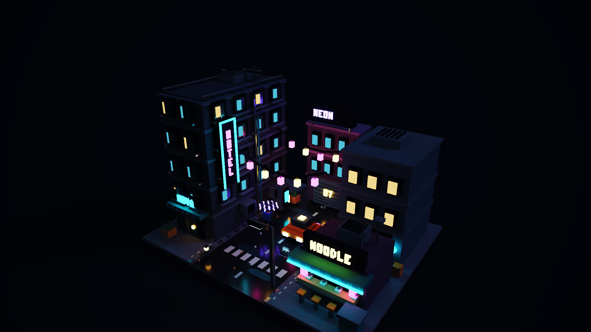

# Neon Alley

A small cyberpunk street, 160 x 128 x 112 voxels (316,352 voxels), built only through the tools of this server.



The image is the application's own Final Render (1920x1080), produced with `export_native_render`. It is not the palette preview and not a screenshot. It was rendered from a file with the same decoded content as the one this script writes.

## Rebuild the scene

```bash
npm ci
npm run build
node examples/neon-alley/build.mjs
```

This writes `neon-alley.act` (the palette) and `neon-alley-night.vox` next to the script. Open the file in MagicaVoxel and press Render.

The script uses: `create_model`, `import_palette_act`, `fill_box`, `set_voxels`, `create_scene`, `set_scene_node`, `set_scene_material`, `set_scene_render_object` and `set_scene_camera`.

## Lighting

- Seven emissive materials (cyan, pink, amber, white, violet, warm and cool windows) carry the neon light.
- The road and puddles use low roughness and a partial metallic response, which gives the wet reflections.
- A cool uniform sky, a soft directional light, exposure, ACES tone mapping and bloom are stored as native render settings. These are the strings MagicaVoxel keeps in the file, not physical units.
- The object is lifted by half its height so that its base sits on the ground plane; this was checked for this single-object scene only.

## Render it through the server (Windows)

```text
MAGICVOXEL_MCP_UI_AUTOMATION=1
attach_magicavoxel_app {}
set_app_camera {focus: true, rx: -24, ry: -35, rz: 0}
export_native_render {path: "render.png", imageWidth: 1920, imageHeight: 1080}
```

MagicaVoxel must be running in Render mode with the scene open. See the main README for what is verified and what is not.
